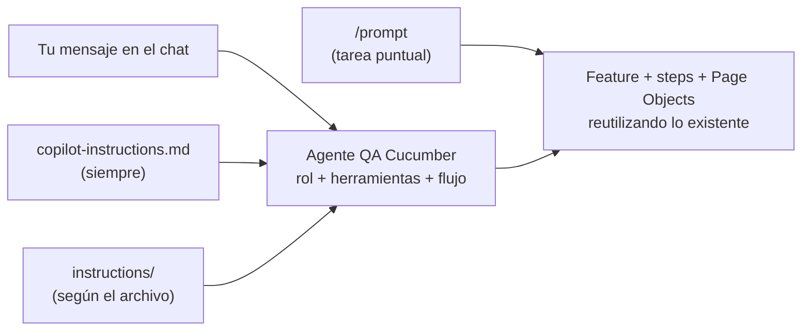

# QA Automation con Playwright + TypeScript + Cucumber

Curso completo de automatización de pruebas — **8 clases · 3 horas cada una** (en la clase 8: 45 min de clase + 2 h 15 min de tarea)

## Requisitos previos

- [Node.js LTS](https://nodejs.org) (v20 o superior)
- [Git](https://git-scm.com)
- [VS Code](https://code.visualstudio.com) + extensión **Playwright Test for VSCode**
- **GitHub Copilot** activo en VS Code, con el chat y el modo agente disponibles
- Cuenta de GitHub con Actions habilitado (para la tarea)

## Configuración para esta clase

Continúas el proyecto de la Clase 7. Esta clase no agrega dependencias npm nuevas: el archivo nuevo es
el agente `.github/agents/qa-cucumber.agent.md`.

- El workflow de esta rama (`.github/workflows/playwright.yml`) solo se dispara en `main`.
- **MCP no forma parte de este repositorio.** Se muestra en una carpeta aparte, limpia (ver B2).

## Ejecutar los tests

```bash
# Tests Playwright (.spec.ts)
npm test
npm run test:smoke

# Tests BDD con Cucumber (.feature)
npm run cucumber
npm run cucumber:smoke
npm run cucumber:regression

# Un feature puntual (el comando que propone el agente)
npm run cucumber -- tests/features/<archivo>.feature
```

## Estructura del proyecto

```
playwright-curso/
├── pages/                          ← Page Objects (reutilizados por spec y steps)
├── tests/
│   ├── clase-01/ … clase-05/        ← specs Playwright acumulativos
│   ├── features/                    ← archivos Gherkin (.feature)
│   ├── step-definitions/            ← implementación de steps Cucumber
│   ├── support/                     ← world.ts (CustomWorld) + hooks.ts
│   └── utils/
│       ├── data/                    ← JSON/CSV para data-driven testing
│       ├── fixtures/                ← Playwright fixtures
│       └── helpers.ts
├── jenkins/                         ← Jenkinsfile + guía (solo referencia, no se ejecuta)
├── .github/
│   ├── workflows/playwright.yml     ← pipeline de CI/CD (GitHub Actions)
│   ├── copilot-instructions.md      ← reglas generales para IA/Copilot
│   ├── instructions/                ← reglas por zona: Cucumber y POM/Playwright
│   ├── prompts/                     ← /generar-casos-cucumber y /generar-page-object
│   ├── agents/                      ← qa-cucumber.agent.md (el agente de esta clase)
│   └── GUIA-IA.md                   ← cómo funciona cada pieza de IA
├── cucumber.json
├── playwright.config.ts             ← reporter nativo html
└── package.json
```

---

# Clase 8 — Agente de IA y MCP de Playwright

> **Duración:** 45 min de clase + 2 h 15 min de tarea &nbsp;|&nbsp; **App:** [saucedemo.com](https://www.saucedemo.com)

## 🎯 Objetivos

- Repasar las piezas de IA del proyecto y entender cuándo usar cada una
- Entender la diferencia entre un prompt y un agente
- Usar el agente `QA Cucumber`, que se apoya en lo que ya existe en el proyecto
- Conocer qué es MCP y cómo se instala el MCP de Playwright en un proyecto (bonus)
- Replicar lo de la Clase 7 en tu propio repositorio (tarea)

---

## B1 — Las piezas de IA y el agente `QA Cucumber` `20 min`

### Repaso: las piezas de IA del proyecto

| Pieza | Archivo | Cuándo se carga | Para qué |
|---|---|---|---|
| Instrucciones generales | `copilot-instructions.md` | Siempre | Reglas que valen para todo el repo |
| Instrucciones por archivo | `instructions/*.instructions.md` | Al trabajar con ciertos archivos | Reglas de una zona concreta (Cucumber, POM) |
| Prompts | `prompts/*.prompt.md` | Cuando los invocas con `/` | Tareas repetibles con datos de entrada |
| **Agentes** | `agents/*.agent.md` | Cuando lo eliges en el selector del chat | Un rol con herramientas y un flujo propios |

Separar las reglas por zona mantiene corto el contexto fijo: las reglas de Cucumber no viajan cuando
editas un Page Object, y al revés. Cada mensaje lleva menos texto irrelevante y la regla aparece
justo donde se necesita.



### Del prompt al agente

| | Prompt | Agente |
|---|---|---|
| Qué es | Una tarea con datos de entrada fijos | Un rol con un flujo de trabajo |
| Cómo se usa | Escribes `/` y lo eliges; se ejecuta de una vez | Lo eliges en el selector y conversas con él |
| Herramientas | Las que tenga el chat | Las limitas tú (por ejemplo, sin terminal) |
| Puede preguntar y seguir | Poco | Sí, es parte de su flujo |
| Cuándo conviene | Tarea corta y repetible | Trabajo de varios pasos que debe planificar |

El agente **no repite las reglas**: recibe las instrucciones generales y las de cada archivo, y su
propio archivo solo las enlaza. Si una regla cambia, se edita en un solo lugar.

### El agente `QA Cucumber`

Vive en [`.github/agents/qa-cucumber.agent.md`](.github/agents/qa-cucumber.agent.md). Su encabezado
define qué es y qué puede hacer:

```yaml
---
name: "QA Cucumber"
description: "Use when: crear o ampliar casos de prueba Cucumber ..."
argument-hint: "Describe el flujo o los casos que quieres automatizar"
tools: [read, search, edit]
---
```

| Campo | Para qué sirve |
|---|---|
| `name` | Nombre que aparece en el selector de agentes |
| `description` | Cuándo usarlo; así lo encuentra Copilot y tú |
| `argument-hint` | Texto de ayuda en la caja del chat |
| `tools` | Herramientas permitidas: leer, buscar y editar archivos |

**Sin terminal, a propósito.** El agente propone el código y el comando; tú lo ejecutas. Así no
lanza pruebas por su cuenta y se mantiene enfocado en un solo rol.

Su flujo tiene cuatro pasos:

1. **Inventario:** lee los steps, features y Page Objects que ya existen.
2. **Plan:** muestra una tabla con cada caso, los steps que reutiliza y los que haría falta crear.
3. **Implementación:** crea el feature, los steps nuevos y, solo si hace falta, el Page Object.
4. **Revisión:** comprueba que no haya steps duplicados y que cada escenario tenga tags.

No inventa reglas de negocio ni selectores: si falta un dato, lo pregunta.

#### Paso a paso — usarlo

1. Abre el chat de Copilot en VS Code.
2. En el selector de agentes elige **QA Cucumber**.
3. Describe un caso, por ejemplo: *"Agrega un escenario que ordene los productos por Name (Z to A) y
   valide el primero"*.
4. Revisa el plan antes de que genere los archivos. Si no conoce el valor esperado, te lo pedirá.
5. Ejecuta el feature con el comando que te indica y revisa el código antes de aceptarlo.

> Esto no reemplaza el criterio del QA: la IA acelera el andamiaje repetitivo, pero validar que el
> flujo de negocio es correcto sigue siendo tuyo.

### Archivos de práctica

- `.github/agents/qa-cucumber.agent.md`
- `.github/GUIA-IA.md`

---

## B2 — MCP de Playwright (bonus) `20 min`

### Qué es MCP

**MCP** (Model Context Protocol) es un protocolo para que la IA use herramientas externas. El MCP de
Playwright le da al agente un **navegador real**: puede abrir una página, leer su estructura y hacer
clic, en lugar de que le pegues los locators a mano.

Sirve para explorar una aplicación nueva, arrancar un proyecto desde cero, obtener locators reales o
depurar un flujo.

**Por qué no está en este repositorio:** el proyecto ya tiene sus Page Objects y sus locators, y MCP
ejecuta código en tu máquina y gasta más tokens con cada página que lee. Por eso se muestra en una
carpeta aparte y limpia.

### ¿Existe un "node_modules" para la IA?

No hay un gestor de paquetes único para agentes. `yarn`, por ejemplo, es otro gestor de paquetes de
Node (como `npm` o `pnpm`) y no tiene que ver con IA. Lo más parecido es MCP:

| En Node | En IA con MCP |
|---|---|
| `package.json` | `.vscode/mcp.json` |
| Paquete de npm | Servidor MCP (por ejemplo, `@playwright/mcp`) |
| `npx` ejecuta el paquete | El mismo `npx` arranca el servidor |

Hay otras piezas de personalización que existen pero que este curso no usa:

| Pieza | Para qué |
|---|---|
| `AGENTS.md` | Instrucciones en un formato que leen varias herramientas de IA |
| Skills (`SKILL.md`) | Flujos con plantillas o scripts incluidos |
| Hooks | Comandos que se ejecutan siempre en ciertos momentos |

#### Paso a paso — instalar el MCP de Playwright en un proyecto

1. Crea una carpeta limpia y ábrela en VS Code:

   ```bash
   mkdir demo-mcp
   cd demo-mcp
   code .
   ```

2. Crea el archivo `.vscode/mcp.json`:

   ```json
   {
     "servers": {
       "playwright": {
         "command": "npx",
         "args": ["@playwright/mcp@latest"]
       }
     }
   }
   ```

3. Inicia el servidor: en `mcp.json` aparece **Start** sobre `playwright` (o usa la paleta de
   comandos con `MCP: List Servers`). VS Code te pedirá confirmar que confías en él.
4. Abre el chat en modo **Agent** y revisa el icono de herramientas: deben aparecer las de Playwright.
5. Pruébalo: *"Abre https://www.saucedemo.com, inicia sesión con standard_user y lista los productos"*.
6. Si pide un navegador, instálalo con `npx playwright install chromium`.

> **Seguridad:** un servidor MCP ejecuta código en tu máquina. Instala solo servidores de fuentes de
> confianza y no uses credenciales reales en las pruebas.

### Archivo de práctica → `.vscode/mcp.json` (en la carpeta aparte)

---

## B3 — Presentación de la tarea `5 min`

La tarea es replicar lo de la Clase 7 en **tu propio repositorio**. Se explica el alcance y los
criterios de entrega (ver más abajo) y quedan 2 h 15 min para trabajarla.

---

## Resumen de la Clase 8

### ✅ Lo que vimos hoy

- Las cuatro piezas de IA del proyecto y cuándo se carga cada una
- Diferencia entre un prompt y un agente
- El agente `QA Cucumber`: rol, herramientas limitadas y flujo de cuatro pasos
- Qué es MCP y cómo instalar el MCP de Playwright en una carpeta aparte

---

## Referencia rápida — Clase 8

| Archivo / Comando | ¿Qué hace? |
|---|---|
| `.github/agents/qa-cucumber.agent.md` | Agente que crea casos Cucumber reutilizando lo existente |
| `.github/GUIA-IA.md` | Cómo funciona cada pieza de IA |
| `npm run cucumber -- tests/features/<archivo>.feature` | Ejecuta un feature puntual |
| `.vscode/mcp.json` | Configuración del servidor MCP (en la carpeta aparte) |

---

## 🎯 Tarea (2 h 15 min)

**Implementa lo de la Clase 7 en tu propio repositorio.** Los pasos detallados de Slack, el
environment y los secrets están en el
[README de la rama `clase-07-cicd`](https://github.com/BrandLuna/playwright-curso/blob/clase-07-cicd/README.md).

1. **Pipeline:** un workflow en `.github/workflows/` con un job de Playwright y uno de Cucumber, que
   use el environment `development`.
2. **Variables y secret:** `BASE_URL`, `SAUCEDEMO_USERNAME` y `SAUCEDEMO_PASSWORD` como variables del
   environment, y `SLACK_WEBHOOK_URL` como secret.
3. **Slack:** una notificación por job al terminar el pipeline.
4. **IA:** `.github/copilot-instructions.md`, al menos una instrucción por archivo y al menos un
   prompt. El agente es opcional.
5. **Prueba de la IA:** genera un caso nuevo con un prompt o con el agente y comprueba que reutiliza
   los steps existentes.

### Criterios de entrega

- [ ] El pipeline termina en verde con ambos jobs.
- [ ] Llega un mensaje a Slack por cada job.
- [ ] Los secretos no están escritos en ningún archivo del repositorio.
- [ ] El repositorio incluye las instrucciones y al menos un prompt.
- [ ] Hay un feature generado con IA que reutiliza steps existentes.

Entrega: enlace a tu repositorio, una captura del pipeline en verde y una captura del mensaje en Slack.
