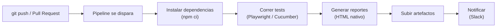
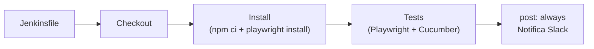

# QA Automation con Playwright + TypeScript + Cucumber

Curso completo de automatización de pruebas — **8 clases · 3 horas cada una**

## 🤖 Uso de IA (GitHub Copilot) en este proyecto

Este proyecto estandariza cómo se usa GitHub Copilot/IA para generar código de automatización,
para que cualquier persona del curso obtenga los mismos patrones sin importar quién pregunte.

- **Estándares y prompts de referencia:** [`.github/copilot-instructions.md`](.github/copilot-instructions.md)
  — convenciones de Page Objects, specs, features, CI/CD, y un ejemplo real completo
  (locators → Page Object → spec → feature) usando `LoginPage` de este mismo repo.
- **Prompt reusable para páginas nuevas:** [`.github/prompts/generar-page-object.prompt.md`](.github/prompts/generar-page-object.prompt.md)
  — le pegas los locators `data-test` de una página nueva y la IA genera el Page Object + spec
  (y feature si lo pides) siguiendo el estándar del proyecto.

**Cómo usarlo:**
1. Abre el Chat de Copilot en VS Code.
2. Escribe `/generar-page-object` y pega el nombre de la página + locators + acciones que necesitas.
3. Revisa el código generado antes de aceptarlo — la IA propone, tú apruebas.

> Esto no reemplaza el criterio del QA: la IA acelera el andamiaje repetitivo (getters, imports,
> estructura), pero la validación de que el flujo de negocio es correcto sigue siendo tuya.

## Requisitos previos

- [Node.js LTS](https://nodejs.org) (v20 o superior)
- [Git](https://git-scm.com)
- [VS Code](https://code.visualstudio.com) + extensión **Playwright Test for VSCode**
- Cuenta de GitHub con Actions habilitado (viene por defecto en repos públicos/privados)
- (Opcional) Un workspace de Slack si quieres probar las notificaciones

## Configuración para esta clase

Continúas el proyecto de la Clase 6. Esta clase no agrega dependencias npm nuevas — el trabajo es
de configuración de CI/CD (GitHub Actions + Jenkins) y notificaciones.

**Configura en el environment `development`** (Settings → Environments → `development`):

- **Environment variables**: `BASE_URL`, `SAUCEDEMO_USERNAME`, `SAUCEDEMO_PASSWORD`
- **Environment secret**: `SLACK_WEBHOOK_URL`

Ejemplo de valores:

```
BASE_URL=https://www.saucedemo.com
SAUCEDEMO_USERNAME=standard_user
SAUCEDEMO_PASSWORD=secret_sauce
SLACK_WEBHOOK_URL=<tu Incoming Webhook de Slack>       # opcional
```

> Si no configuras `SLACK_WEBHOOK_URL`, ese paso del pipeline se omite automáticamente — no hace
> falta tenerlo configurado para que el resto del pipeline funcione.

**Revisa el pipeline ya armado** en `.github/workflows/playwright.yml` y la carpeta `jenkins/`
(material de aprendizaje, no se ejecuta automáticamente).

**Usa reportes nativos** para mantener la clase simple:
- Playwright: reporte HTML nativo (`playwright-report/`)
- Cucumber: formatter HTML nativo (`cucumber-report.html`)

## Ejecutar los tests

```bash
# Tests Playwright (.spec.ts)
npm test
npm run test:smoke

# Tests BDD con Cucumber (.feature)
npm run cucumber
npm run cucumber:smoke
npm run cucumber:regression

# Abrir reporte nativo de Playwright
npm run test:report
```

## Estructura del proyecto

```
playwright-curso/
├── pages/                          ← Page Objects (reutilizados por spec y steps)
├── tests/
│   ├── clase-01/ … clase-05/        ← specs Playwright acumulativos
│   ├── features/                    ← archivos Gherkin (.feature)
│   ├── step-definitions/            ← implementación de steps Cucumber
│   ├── support/                     ← world.ts (CustomWorld) + hooks.ts
│   └── utils/
│       ├── data/                    ← JSON/CSV para data-driven testing
│       ├── fixtures/                ← Playwright fixtures
│       └── helpers.ts
├── jenkins/                         ← Jenkinsfile + guía (demo del instructor)
│   ├── Jenkinsfile
│   └── README.md
├── .github/
│   ├── workflows/playwright.yml     ← pipeline principal de CI/CD (GitHub Actions)
│   └── copilot-instructions.md      ← estándares de código y prompts para IA/Copilot
├── cucumber.json
├── playwright.config.ts             ← reporter nativo html
└── package.json
```

---

# Clase 7 — CI/CD completo, Jenkins y estandarización de IA

> **Duración:** 3 horas &nbsp;|&nbsp; **App:** [saucedemo.com](https://www.saucedemo.com)

## 🎯 Objetivos

- Entender los conceptos de CI/CD y mapear los términos entre GitHub Actions y Jenkins
- Consolidar el pipeline de GitHub Actions como flujo principal de CI/CD
- Configurar y correr Jenkins como alternativa (material de aprendizaje, carpeta separada)
- Configurar notificaciones a Slack al finalizar el pipeline
- Trabajar con reportes nativos de Playwright y Cucumber en CI/CD
- Adoptar un uso estandarizado de GitHub Copilot en el proyecto

---

## B1 — Conceptos de CI/CD: Jenkins vs GitHub Actions `30 min`

Como esta clase no usa diapositivas, estos cuadros reemplazan al "ppt": sirven para fijar los
términos antes de ver cada herramienta en la práctica.

### ¿Qué hace un pipeline de CI/CD?

En cada `push` o Pull Request, el pipeline repite siempre la misma secuencia, sin intervención
manual:



### Mismo concepto, distinto nombre según la herramienta

| Concepto | GitHub Actions | Jenkins |
|---|---|---|
| Archivo de definición | `.yml` en `.github/workflows/` | `Jenkinsfile` (Groovy) |
| Unidad de trabajo que corre en paralelo | `job` | `stage` |
| Paso individual dentro de la unidad | `step` | paso dentro de un `stage` |
| Máquina que ejecuta el pipeline | `runner` (hospedado por GitHub) | `agent` (servidor propio) |
| Valor secreto (webhook, password) | `secret` (Settings → Secrets/Environments) | `credential` (Manage Jenkins → Credentials) |
| Archivo generado para descargar | `artifact` (`actions/upload-artifact`) | `archiveArtifacts` / `publishHTML` |
| Qué dispara la ejecución | `on: push / pull_request / workflow_dispatch` | Webhook de SCM o *Build Now* manual |

### Comparativa general

| | GitHub Actions | Jenkins |
|---|---|---|
| Infraestructura | Nube de GitHub (sin instalar nada) | Servidor propio (self-hosted) |
| Configuración | `.yml` versionado en el repo | `Jenkinsfile` + configuración en el panel |
| Costo | Gratis en repos públicos / minutos incluidos en privados | Servidor propio (EC2, VPS, on-premise...) |
| Curva de aprendizaje | Baja | Media-alta |
| Uso en la industria | Muy común en startups y proyectos cloud-native | Muy común en empresas grandes / legacy |
| Rol en este curso | **Flujo principal** | Material de aprendizaje |

> Esta misma tabla vive también en [`jenkins/README.md`](jenkins/README.md) por si quieres
> profundizar en Jenkins por tu cuenta, con los mismos datos para no tener dos versiones distintas.

### Archivos de práctica

- `.github/workflows/playwright.yml`
- `jenkins/Jenkinsfile`

---

## B2 — Pipeline de GitHub Actions `55 min`

Definido en [`.github/workflows/playwright.yml`](.github/workflows/playwright.yml). Se dispara con
`push`/`pull_request` hacia `main`/`clase-07-cicd`, o manualmente (`workflow_dispatch`).

```
push / pull_request → GitHub Actions
         ├── Job "playwright"  → npx playwright test tests/clase-05/01-pom-basico.spec.ts --project=chromium
         │                       sube playwright-report/
         │                       notifica Slack con el resultado de ESTE job
         └── Job "cucumber"    → cucumber sobre tests/features/flujo-de-compra.feature
                                  sube cucumber-report.html
                                  notifica Slack con el resultado de ESTE job
```

Los dos jobs corren en paralelo y son independientes **a propósito**: sirven para comparar, lado a
lado, cómo se ve el pipeline con el enfoque clásico de Playwright y cómo se ve con BDD. Cada uno
notifica su propio resultado — no hay un job de notificación consolidado.

### Scope fijo en Clase 7 (rápido para demo)

- Playwright corre `tests/clase-05/01-pom-basico.spec.ts` con `--project=chromium`.
- Cucumber corre `tests/features/flujo-de-compra.feature`.
- Mantener este alcance acotado reduce tiempos y hace más predecible la demo en vivo.

Ejemplos rápidos:

- Solo Playwright smoke en carpeta puntual:
   `test_suite=playwright`, `playwright_paths=tests/clase-05`, `playwright_grep=@smoke`
- Solo Cucumber regression en dos features:
   `test_suite=cucumber`, `cucumber_paths=tests/features/flujo-de-compra.feature,tests/features/environments.feature`, `cucumber_tag=@regression`

### Variables y secrets necesarios

| Tipo | Nombre | Uso |
|---|---|
| Variable | `BASE_URL` | URL base de la app |
| Variable | `SAUCEDEMO_USERNAME` / `SAUCEDEMO_PASSWORD` | Credenciales usadas en los tests |
| Secret | `SLACK_WEBHOOK_URL` | Incoming Webhook de Slack (opcional) |

### Archivo de práctica → [`.github/workflows/playwright.yml`](.github/workflows/playwright.yml)

---

## B3 — Jenkins paso a paso + Estandarización de IA `25 min`

### Jenkins como material de aprendizaje

Esta clase se centra en GitHub Actions — Jenkins solo se muestra de forma básica, para ver que
**ejecutar el mismo pipeline en otra herramienta es un proceso análogo** (mismos comandos
`npm ci` / `playwright test` / `cucumber`, solo cambia dónde y cómo se configuran). El detalle
completo (plugins, credenciales, etc.) queda documentado en [`jenkins/README.md`](jenkins/README.md)
para quien quiera profundizar por su cuenta.



#### Paso a paso — lo mínimo para correrlo una vez

1. **Levantar Jenkins con Java 21 (sin Docker)** y abrir `http://localhost:8080`:

   ```powershell
   New-Item -ItemType Directory -Path C:\jenkins -Force | Out-Null
   Set-Location C:\jenkins
   Invoke-WebRequest -Uri "https://get.jenkins.io/war-stable/latest/jenkins.war" -OutFile "jenkins.war"
   & "C:\Program Files\Eclipse Adoptium\jdk-21.0.12.101-hotspot\bin\java.exe" -jar "C:\jenkins\jenkins.war" --httpPort=8080
   ```

   Jenkins actual requiere **Java 21+**. Si en consola ves error por Java 17, instala Java 21 y
   vuelve a lanzar el mismo comando.

2. **Crear un Pipeline job** → **New Item → Pipeline** → Pipeline script from SCM → Script Path
   `jenkins/Jenkinsfile` (mismo rol que el `.yml` en GitHub Actions).

3. **Build Now** y revisar la consola — corre los mismos comandos que ya conoces de Actions.

> Plugins, credenciales y configuración de NodeJS necesarios para que el build pase en verde están
> detallados paso a paso en [`jenkins/README.md`](jenkins/README.md).

### Estandarización de IA / Copilot

Las convenciones de código, nombrado y prompts reutilizables del proyecto están documentadas en
[`.github/copilot-instructions.md`](.github/copilot-instructions.md). Úsalo como referencia antes
de pedirle a Copilot que genere Page Objects, tests, features o cambios al pipeline.

Cómo funcionan las instrucciones y los prompts (`/generar-page-object`, `/generar-casos-cucumber`,
`/revisar-bdd`) y qué otras piezas existen está explicado en [`.github/GUIA-IA.md`](.github/GUIA-IA.md).

### Archivos de práctica

- `jenkins/Jenkinsfile`
- `jenkins/README.md`
- `.github/copilot-instructions.md`
- `.github/GUIA-IA.md`

---

## B4 — Notificaciones a Slack + Reportes nativos `40 min`

### Slack (por job)

Usa la Action oficial `slackapi/slack-github-action@v2.1.0` con un Incoming Webhook, mandando un
payload en formato Block Kit con el resultado del job, la rama, el commit y el link al run.

#### Paso a paso — Crear el Incoming Webhook y conectarlo al pipeline

1. **Crear la app de Slack.** Entra a [api.slack.com/apps](https://api.slack.com/apps) → **Your Apps**
   → **Create New App**.

   

2. **Elegir "From scratch".** En el modal **Create an app**, selecciona **From scratch** (en vez de
   usar un manifest).

   

3. **Nombrar la app y elegir el workspace.** Ponle un **App Name** (ej. `prueba-ci`) y selecciona el
   workspace donde quieres recibir las notificaciones (ej. `QA MOON`) → **Create App**.

   

4. **Activar Incoming Webhooks.** En el menú lateral entra a **Incoming Webhooks**, activa el
   toggle **Activate Incoming Webhooks** y baja hasta **Add New Webhook**.

   

5. **Copiar la Webhook URL.** Slack genera una URL única (`https://hooks.slack.com/services/...`)
   asociada a un canal (ej. `playwright-ci`). Cópiala con el botón **Copy** — nunca debe quedar
   escrita en el código.

   

6. **Autorizar la app en el workspace y canal.** Confirma el **Workspace** y el **Canal para
   webhook**, y pulsa **Permitir** para que la app quede autorizada a publicar ahí.

   

7. **Crear/usar el Environment en GitHub.** El workflow declara `environment: development` en cada
   job, así que el secret se agrega ahí (no en los secrets generales del repo): **Settings →
   Environments → New environment** (o entra al que ya exista, `development`).

   

8. **Agregar el secret al Environment.** Dentro del environment `development`, ve a **Environment
   secrets → Add environment secret**.

   

9. **Guardar `SLACK_WEBHOOK_URL`.** Nombre `SLACK_WEBHOOK_URL`, valor la Webhook URL copiada en el
   paso 5 → **Add secret**.

   

El paso `Notify Slack` de [`.github/workflows/playwright.yml`](.github/workflows/playwright.yml) ya
lee `secrets.SLACK_WEBHOOK_URL` dentro del `environment: development` — no hace falta tocar el YAML,
solo configurar el secret como arriba. Al correr el pipeline (push o `workflow_dispatch`), el
mensaje debe llegar al canal elegido.

> Si el secret `SLACK_WEBHOOK_URL` no está configurado, la Action de Slack falla ese paso puntual,
> pero no afecta el resto del job — los tests y la subida de reportes siguen corriendo igual.

### Reportes nativos

- Playwright genera `playwright-report/` automáticamente en cada corrida.
- Cucumber genera `cucumber-report.html` automáticamente en cada corrida.
- En GitHub Actions ambos se suben como artefactos (`playwright-report` y `cucumber-report`).

### Archivo de práctica → `.github/workflows/playwright.yml` (paso `Notify Slack`)

---

## Resumen de la Clase 7

### ✅ Lo que vimos hoy

- Conceptos de CI/CD y tabla de equivalencias entre GitHub Actions y Jenkins
- Pipeline de GitHub Actions con dos jobs paralelos (Playwright y Cucumber)
- Jenkins levantado y configurado localmente, corriendo el mismo pipeline
- Notificaciones a Slack por job/stage
- Reportes nativos (Playwright + Cucumber) generados en cada corrida
- Estandarización del uso de IA/Copilot con `.github/copilot-instructions.md`

### 🔜 Clase 8 — Proyecto Final, MCP & Cierre

- Repaso integral del framework completo (POM + BDD + CI/CD)
- README profesional listo para portfolio
- Criterios de evaluación del proyecto final
- Extra: introducción a Playwright MCP

---

## Referencia rápida — Clase 7

| Comando / Archivo | ¿Qué hace? |
|---|---|
| `npm run test:report` | Abre el reporte HTML nativo de Playwright |
| `.github/workflows/playwright.yml` | Pipeline principal (GitHub Actions) |
| `jenkins/Jenkinsfile` | Pipeline equivalente para Jenkins (demo) |
| `.github/copilot-instructions.md` | Estándares de código y prompts para Copilot |

---

## 🎯 Tarea para la próxima clase

1. Configura el webhook de Slack y confirma que te llega la notificación
2. Revisa `jenkins/README.md` y entiende las diferencias frente a GitHub Actions
3. Verifica que el pipeline sigue en verde con ambos jobs (Playwright y Cucumber)

Prueba-cicd