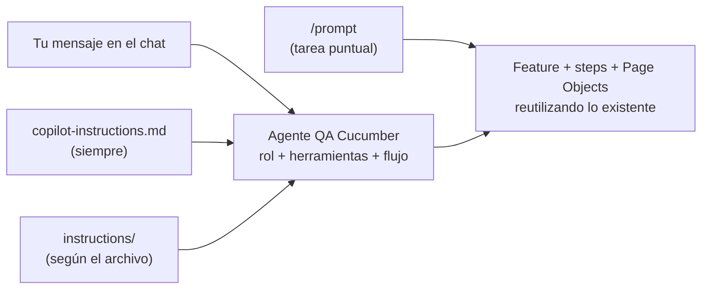
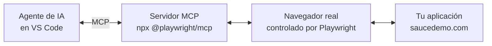

# QA Automation con Playwright + TypeScript + Cucumber

Curso completo de automatización de pruebas — **8 clases · 3 horas cada una** (en la clase 8: 45 min de clase + 2 h 15 min de trabajo guiado, con entrega hasta 5 días después)

## Requisitos previos

- [Node.js LTS](https://nodejs.org) (v20 o superior)
- [Git](https://git-scm.com)
- [VS Code](https://code.visualstudio.com) + extensión **Playwright Test for VSCode**
- **GitHub Copilot** activo en VS Code, con el chat y el modo agente disponibles
- Cuenta de GitHub con Actions habilitado (para la tarea)

## Configuración para esta clase

Continúas el proyecto de la Clase 7. Esta clase no agrega dependencias npm nuevas: el archivo nuevo es
el agente `.github/agents/qa-cucumber.agent.md`.

- El workflow de esta rama (`.github/workflows/playwright.yml`) solo se dispara en `main`.
- **MCP no forma parte de este repositorio.** Se muestra en una carpeta aparte, limpia (ver B2).

## Ejecutar los tests

```bash
# Tests Playwright (.spec.ts)
npm test
npm run test:smoke

# Tests BDD con Cucumber (.feature)
npm run cucumber
npm run cucumber:smoke
npm run cucumber:regression

# Un feature puntual (el comando que usa el agente)
npm run cucumber -- tests/features/<archivo>.feature
```

## Estructura del proyecto

```
playwright-curso/
├── pages/                          ← Page Objects (reutilizados por spec y steps)
├── tests/
│   ├── clase-01/ … clase-05/        ← specs Playwright acumulativos
│   ├── features/                    ← archivos Gherkin (.feature)
│   ├── step-definitions/            ← implementación de steps Cucumber
│   ├── support/                     ← world.ts (CustomWorld) + hooks.ts
│   └── utils/
│       ├── data/                    ← JSON/CSV para data-driven testing
│       ├── fixtures/                ← Playwright fixtures
│       └── helpers.ts
├── jenkins/                         ← Jenkinsfile + guía (solo referencia, no se ejecuta)
├── .github/
│   ├── workflows/playwright.yml     ← pipeline de CI/CD (GitHub Actions)
│   ├── copilot-instructions.md      ← reglas generales para IA/Copilot
│   ├── instructions/                ← reglas por zona: Cucumber y POM/Playwright
│   ├── prompts/                     ← /generar-casos-cucumber y /generar-page-object
│   ├── agents/                      ← qa-cucumber.agent.md (el agente de esta clase)
│   └── GUIA-IA.md                   ← cómo funciona cada pieza de IA
├── cucumber.json
├── playwright.config.ts             ← reporter nativo html
└── package.json
```

---

# Clase 8 — Agente de IA y MCP de Playwright

> **Duración:** 45 min de clase + 2 h 15 min de trabajo guiado (entrega hasta 5 días después) &nbsp;|&nbsp; **App:** [saucedemo.com](https://www.saucedemo.com)

## 🎯 Objetivos

- Repasar las piezas de IA del proyecto y entender cuándo usar cada una
- Entender la diferencia entre un prompt y un agente
- Usar el agente `QA Cucumber`, que se apoya en lo que ya existe en el proyecto
- Conocer qué es MCP y cómo se instala el MCP de Playwright en un proyecto (bonus)
- Desarrollar un flujo de compra completo con CI/CD en GitHub Actions y notificación a Slack, en tu propio repositorio (tarea)

---

## B1 — Las piezas de IA y el agente `QA Cucumber` `20 min`

### Repaso: las piezas de IA del proyecto

| Pieza | Archivo | Cuándo se carga | Para qué |
|---|---|---|---|
| Instrucciones generales | `copilot-instructions.md` | Siempre | Reglas que valen para todo el repo |
| Instrucciones por archivo | `instructions/*.instructions.md` | Al trabajar con ciertos archivos | Reglas de una zona concreta (Cucumber, POM) |
| Prompts | `prompts/*.prompt.md` | Cuando los invocas con `/` | Tareas repetibles con datos de entrada |
| **Agentes** | `agents/*.agent.md` | Cuando lo eliges en el selector del chat | Un rol con herramientas y un flujo propios |

Separar las reglas por zona mantiene corto el contexto fijo: las reglas de Cucumber no viajan cuando
editas un Page Object, y al revés. Cada mensaje lleva menos texto irrelevante y la regla aparece
justo donde se necesita.



### Del prompt al agente

| | Prompt | Agente |
|---|---|---|
| Qué es | Una tarea con datos de entrada fijos | Un rol con un flujo de trabajo |
| Cómo se usa | Escribes `/` y lo eliges; se ejecuta de una vez | Lo eliges en el selector y conversas con él |
| Herramientas | Las que tenga el chat | Las limitas tú (por ejemplo, solo lo que el rol necesita) |
| Puede preguntar y seguir | Poco | Sí, es parte de su flujo |
| Cuándo conviene | Tarea corta y repetible | Trabajo de varios pasos que debe planificar |

El agente **no repite las reglas**: recibe las instrucciones generales y las de cada archivo, y su
propio archivo solo las enlaza. Si una regla cambia, se edita en un solo lugar.

### El agente `QA Cucumber`

Vive en [`.github/agents/qa-cucumber.agent.md`](.github/agents/qa-cucumber.agent.md). Su encabezado
define qué es y qué puede hacer:

```yaml
---
name: "QA Cucumber"
description: "Use when: crear o ampliar casos de prueba Cucumber ..."
argument-hint: "Describe el flujo o los casos que quieres automatizar"
tools: [read, search, edit, execute]
---
```

| Campo | Para qué sirve |
|---|---|
| `name` | Nombre que aparece en el selector de agentes |
| `description` | Cuándo usarlo; así lo encuentra Copilot y tú |
| `argument-hint` | Texto de ayuda en la caja del chat |
| `tools` | Herramientas permitidas: leer, buscar y editar archivos, y usar la terminal (`execute`) |

**Terminal con límite.** El agente solo la usa para ejecutar el feature que acaba de crear; no
instala paquetes ni usa git. Esa restricción está escrita en su archivo, y `tools` define qué
herramientas existen para él: sin `execute`, no tendría terminal.

Su flujo tiene cinco pasos:

| Paso | Qué hace | Herramienta |
|---|---|---|
| 1. Inventario | Lee los steps, features y Page Objects que ya existen | `read`, `search` |
| 2. Plan | Muestra una tabla con cada caso, los steps que reutiliza y los que haría falta crear | Solo conversa |
| 3. Implementación | Crea el feature, los steps nuevos y, solo si hace falta, el Page Object | `edit` |
| 4. Revisión | Comprueba que no haya steps duplicados y que cada escenario tenga tags | `read` |
| 5. Ejecución | Corre solo el feature creado y te muestra el resultado | `execute` |

No inventa reglas de negocio ni selectores: si falta un dato, lo pregunta.

#### Paso a paso — usarlo

1. Abre el chat de Copilot en VS Code.
2. En el selector de agentes elige **QA Cucumber**.
3. Describe un caso, por ejemplo: *"Agrega un escenario que ordene los productos por Name (Z to A) y
   valide el primero"*.
4. Revisa el plan antes de que genere los archivos. Si no conoce el valor esperado, te lo pedirá.
5. Revisa el resultado de la ejecución y el código antes de aceptarlo.

> Esto no reemplaza el criterio del QA: la IA acelera el andamiaje repetitivo, pero validar que el
> flujo de negocio es correcto sigue siendo tuyo.

### Cómo se crea un agente

1. Crea un archivo en `.github/agents/` con extensión `.agent.md`, por ejemplo `qa-cucumber.agent.md`.
   Ahí lo comparte todo el repositorio; en la carpeta de tu perfil de VS Code sería solo para ti.
2. Escribe el **encabezado** entre `---` con su configuración.
3. Escribe el **cuerpo** en Markdown: quién es, qué no debe hacer y cómo trabaja.
4. Elígelo en el selector de agentes del chat y pruébalo con un caso real.

Plantilla mínima:

```markdown
---
description: "Use when: <cuándo usarlo y palabras clave>"
tools: [read, search]
---
Eres un <rol>. Tu trabajo es <objetivo>.

## Límites
- NO <lo que no debe hacer>

## Cómo trabajas
1. <paso>

## Formato de la respuesta
<qué devuelve>
```

#### Anatomía de `qa-cucumber.agent.md`

| Parte | Qué contiene | En este agente |
|---|---|---|
| Encabezado | Configuración: `name`, `description`, `argument-hint`, `tools` | Las cuatro primeras líneas |
| Rol | Quién es y qué hace, en una o dos frases | "Eres un QA de automatización…" |
| Enlaces a instrucciones | Las reglas que reutiliza, sin copiarlas | `cucumber.instructions.md` y `playwright-pom.instructions.md` |
| Límites | Lo que no debe hacer ni tocar | Sección "Límites" |
| Cómo trabaja | Los pasos, en orden | Inventario, plan, implementación, revisión y ejecución |
| Formato de la respuesta | Qué entrega al terminar | Archivos, steps, supuestos y resultado |

#### Cómo funciona `tools`

`tools` es la lista de herramientas que el agente puede usar. Lo que no está en la lista **no existe
para él**: no puede usarlo aunque se lo pidas.

| Herramienta | Qué permite |
|---|---|
| `read` | Leer archivos |
| `search` | Buscar archivos o texto en el proyecto |
| `edit` | Crear y modificar archivos |
| `execute` | Ejecutar comandos en la terminal |
| `web` | Consultar URLs y buscar en la web |
| `todo` | Llevar una lista de tareas |
| `agent` | Invocar a otros agentes |

Combinaciones habituales:

| `tools` | Resultado |
|---|---|
| `[read, search]` | Investiga y revisa, sin modificar nada |
| `[read, search, edit]` | Crea y edita código, pero no ejecuta nada |
| `[read, search, edit, execute]` | Como `qa-cucumber`: además corre comandos |
| `[]` | Solo conversa, sin tocar el proyecto |

- Si omites `tools`, el agente usa las herramientas por defecto.
- Dale solo lo que su rol necesita: más herramientas lo hacen más disperso y aumentan el riesgo.
- Los servidores MCP también aparecen aquí, con la forma `servidor/*` (se ve en B2).
- `tools` define qué existe; **cómo** usarlo se escribe en el cuerpo. Por eso `qa-cucumber` tiene
  `execute`, pero sus límites le piden usar la terminal solo para correr su feature.

#### Errores comunes

- **Descripción vaga.** `description` es lo que permite elegirlo: incluye "Use when:" y palabras
  clave del trabajo que hace.
- **Comillas.** Si la descripción lleva `:`, escríbela entre comillas o el encabezado se rompe sin
  avisar.
- **Demasiadas herramientas.** Un agente que lo hace todo termina sin un rol claro.

### Archivos de práctica

- `.github/agents/qa-cucumber.agent.md`
- `.github/GUIA-IA.md`

---

## B2 — MCP de Playwright (bonus) `20 min`

### Qué es MCP

**MCP** (Model Context Protocol) es un protocolo para que la IA use herramientas externas. El MCP de
Playwright le da al agente un **navegador real**: puede abrir una página, leer su estructura y hacer
clic, en lugar de que le pegues los locators a mano.



Sirve para explorar una aplicación nueva, arrancar un proyecto desde cero, obtener locators reales o
depurar un flujo.

**Por qué no está en este repositorio:** el proyecto ya tiene sus Page Objects y sus locators, y MCP
ejecuta código en tu máquina y gasta más tokens con cada página que lee. Por eso se muestra en una
carpeta aparte y limpia.

### ¿Existe un "node_modules" para la IA?

No hay un gestor de paquetes único para agentes. `yarn`, por ejemplo, es otro gestor de paquetes de
Node (como `npm` o `pnpm`) y no tiene que ver con IA. Lo más parecido es MCP:

| En Node | En IA con MCP |
|---|---|
| `package.json` | `.vscode/mcp.json` |
| Paquete de npm | Servidor MCP (por ejemplo, `@playwright/mcp`) |
| `npx` ejecuta el paquete | El mismo `npx` arranca el servidor |

Hay otras piezas de personalización que existen pero que este curso no usa:

| Pieza | Para qué |
|---|---|
| `AGENTS.md` | Instrucciones en un formato que leen varias herramientas de IA |
| Skills (`SKILL.md`) | Flujos con plantillas o scripts incluidos |
| Hooks | Comandos que se ejecutan siempre en ciertos momentos |

#### Paso a paso — instalar el MCP de Playwright en un proyecto

1. Crea una carpeta limpia y ábrela en VS Code:

   ```bash
   mkdir demo-mcp
   cd demo-mcp
   code .
   ```

2. Crea el archivo `.vscode/mcp.json`:

   ```json
   {
     "servers": {
       "playwright": {
         "command": "npx",
         "args": ["@playwright/mcp@latest"]
       }
     }
   }
   ```

3. Inicia el servidor: en `mcp.json` aparece **Start** sobre `playwright` (o usa la paleta de
   comandos con `MCP: List Servers`). VS Code te pedirá confirmar que confías en él.
4. Abre el chat en modo **Agent** y revisa el icono de herramientas: deben aparecer las de Playwright.
5. Prueba rápida, solo para comprobar que MCP responde: *"Abre https://www.saucedemo.com, inicia sesión con standard_user y lista los productos"*.
6. Si pide un navegador, instálalo con `npx playwright install chromium`.

> **Seguridad:** un servidor MCP ejecuta código en tu máquina. Instala solo servidores de fuentes de
> confianza y no uses credenciales reales en las pruebas.

#### Prompt de la demo — crear un proyecto base con POM

Este es el prompt que se usa en la demo. Con el servidor MCP iniciado y el chat en modo **Agent**,
pega esto en la carpeta vacía:

```text
Crea un proyecto Playwright + TypeScript con Page Object Model para https://www.saucedemo.com en esta carpeta vacía.

1. Con el navegador MCP, recorre login, inventario y carrito, y anota los selectores data-test reales. No inventes ninguno.

2. Estructura:
   pages/BasePage.ts, LoginPage.ts, InventoryPage.ts, CartPage.ts
   tests/specs/compra.spec.ts
   playwright.config.ts, .env.example, .gitignore

3. Reglas:
   - BasePage con goto, expectURL y expectErrorMessage; todas las páginas la extienden.
   - Locators como getters con data-test; métodos de negocio en español; validaciones con prefijo expect.
   - Los specs solo llaman métodos de las páginas, sin locators. Etiquetas { tag: '@smoke' }.
   - Sin page.click(selector), page.fill(selector, valor) ni waitForTimeout.
   - BASE_URL, SAUCEDEMO_USERNAME y SAUCEDEMO_PASSWORD desde .env con dotenv y "valor?.trim() || 'defecto'".
   - Config: baseURL, solo Chromium, reporter html.

4. Casos: login exitoso, login con credenciales incorrectas y agregar un producto al carrito validando el contador.

5. Instala dependencias, ejecuta npx playwright test y dime el resultado. Si un locator falla, vuelve a inspeccionar con MCP.
```

Qué hace cada parte:

| Parte | Para qué sirve |
|---|---|
| 1. Exploración con MCP | Obtiene los locators reales de la página en lugar de inventarlos |
| 2. Estructura | Fija la forma del proyecto: `pages/` para los Page Objects y `tests/specs/` para los tests |
| 3. Reglas | Las mismas convenciones de este curso: `BasePage`, getters `data-test`, specs sin locators y variables en `.env` |
| 4. Casos | Tres escenarios acotados para gastar pocos tokens |
| 5. Verificación | Ejecuta las pruebas y corrige los locators que fallen |

Solo explora tres pantallas (login, inventario y carrito) porque cada página que MCP lee devuelve una
captura larga y eso es lo que más tokens consume.

### Archivo de práctica → `.vscode/mcp.json` (en la carpeta aparte)

---

## B3 — Presentación de la tarea `5 min`

Se explica la tarea final (ver más abajo): un flujo de compra completo con CI/CD y Slack en **tu
propio repositorio**. Los 2 h 15 min restantes trabajas en clase, con el instructor y la IA para
resolver dudas, y puedes entregarla hasta 5 días después.

---

## Resumen de la Clase 8

### ✅ Lo que vimos hoy

- Las cuatro piezas de IA del proyecto y cuándo se carga cada una
- Diferencia entre un prompt y un agente
- El agente `QA Cucumber`: rol, herramientas limitadas y flujo de cinco pasos
- Qué es MCP y cómo instalar el MCP de Playwright en una carpeta aparte

---

## Referencia rápida — Clase 8

| Archivo / Comando | ¿Qué hace? |
|---|---|
| `.github/agents/qa-cucumber.agent.md` | Agente que crea casos Cucumber reutilizando lo existente |
| `.github/GUIA-IA.md` | Cómo funciona cada pieza de IA |
| `npm run cucumber -- tests/features/<archivo>.feature` | Ejecuta un feature puntual |
| `.vscode/mcp.json` | Configuración del servidor MCP (en la carpeta aparte) |

---

## 🎯 Tarea final

**Desarrolla, en tu propio repositorio, un flujo de compra completo con CI/CD en GitHub Actions y
notificación a Slack.** Partes del proyecto que construiste durante el curso y usas la misma
página: [saucedemo.com](https://www.saucedemo.com).

| Aspecto | Detalle |
|---|---|
| Dónde trabajas | En tu propio repositorio de GitHub |
| Tiempo en clase | 2 h 15 min, con el instructor disponible para resolver dudas |
| Fecha límite | Hasta 5 días después de la clase |
| Entrega | El enlace a tu repositorio |
| IA | Permitida: puedes usar Copilot, los prompts y el agente del curso |

### Qué debes construir

**1. El flujo de compra completo.** Automátizalo con tus Page Objects, de punta a punta:

| Pantalla | Qué debe hacer tu flujo |
|---|---|
| Login | Iniciar sesión con las credenciales del entorno |
| Inventario | Agregar uno o más productos y validar el contador del carrito |
| Carrito | Comprobar los productos y avanzar al checkout |
| Checkout, datos | Completar nombre, apellido y código postal |
| Checkout, resumen | Revisar el pedido y finalizar la compra |
| Confirmación | Validar el mensaje de pedido completado |

**2. El pipeline de la Clase 7, ejecutando ese flujo:**

- Un workflow en `.github/workflows/` que se dispare con cada `push`.
- Las variables de GitHub Actions, en el environment `development` de tu repositorio:
  `BASE_URL`, `SAUCEDEMO_USERNAME` y `SAUCEDEMO_PASSWORD`. El workflow las lee desde ahí, no desde
  el código.
- Los jobs que tengas (en la Clase 7 son dos: Playwright y Cucumber).

**3. La notificación a Slack:** un mensaje por job al terminar, con el webhook guardado como secret
`SLACK_WEBHOOK_URL` en el mismo environment. Los pasos para crearlo están en el
[README de la rama `clase-07-cicd`](https://github.com/BrandLuna/playwright-curso/blob/clase-07-cicd/README.md).

### Criterios de entrega

- [ ] El flujo de compra cubre todas las pantallas de la tabla, del login a la confirmación.
- [ ] El pipeline corre en GitHub Actions y termina en verde.
- [ ] La URL y las credenciales se leen de las variables del environment, no están en el código.
- [ ] Llega un mensaje a Slack por cada job.
- [ ] El webhook de Slack está guardado como secret y no aparece en ningún archivo del repositorio.
- [ ] El repositorio es accesible para quien lo revise.

**Entrega final:** el enlace a tu repositorio, hasta 5 días después de la clase.
